# Experiment 1: Image Handling and Pixel Transformations Using OpenCV

# **Name:** RAMITHA CHOWDARY S  
# **Register Number:** 212224240130 

---

## AIM

To perform image handling and pixel transformations using Python and OpenCV, including reading and displaying images, drawing shapes, adding text, color space conversion, pixel manipulation, image resizing, cropping, flipping, and saving the modified image.

## SOFTWARE REQUIRED

- Python
- OpenCV
- Matplotlib
- Jupyter Notebook
- Anaconda (optional)

## INSTALLATION

Install the required libraries using the following command:

```bash
pip install opencv-contrib-python-headless matplotlib
```

## ALGORITHM

### Step 1: Read and Display an Image

1. Import OpenCV and Matplotlib libraries.
2. Read an image from the local directory using `cv2.imread()`.
3. Convert the image from BGR to RGB.
4. Display the original image using Matplotlib.

### Step 2: Draw Shapes and Add Text

1. Draw a line from the top-left to the bottom-right of the image.
2. Draw a circle at the center of the image.
3. Draw a rectangle around the image.
4. Add the text "OpenCV Drawing" at the top-left corner.

### Step 3: Color Space Conversion

1. Convert the RGB image to HSV and display it.
2. Convert the RGB image to grayscale and display it.
3. Convert the RGB image to YCrCb and display it.
4. Convert the HSV image back to RGB and display it.

### Step 4: Pixel Manipulation

1. Access and print the pixel value at coordinates `(100, 100)`.
2. Change the pixel at coordinates `(200, 200)` to white.
3. Modify a region of the image to white.
4. Display the modified image.

### Step 5: Image Resizing

1. Read the original image.
2. Resize the image to half its original width and height.
3. Display the resized image.

### Step 6: Image Cropping

1. Read the original image.
2. Extract a region of interest starting at `(50, 50)`.
3. Display the cropped image.

### Step 7: Image Flipping

1. Flip the original image horizontally.
2. Flip the original image vertically.
3. Display both flipped images.

### Step 8: Save the Final Modified Image

1. Save the modified image in the local directory using `cv2.imwrite()`.
2. Verify that the image has been saved successfully.

---

## PROGRAM

### Step 1: Read and Display an Image

```python
import cv2
import matplotlib.pyplot as plt

# Read the image using OpenCV
img = cv2.imread('ramitha.png', cv2.IMREAD_COLOR)

# Convert BGR (OpenCV's default) to RGB (Matplotlib's expected color order)
img_rgb = cv2.cvtColor(img, cv2.COLOR_BGR2RGB)

# Display the image using Matplotlib
plt.imshow(img_rgb, cmap='viridis')
plt.title("Original Image")
plt.axis('off')
plt.show()
```

### Step 2: Draw Shapes and Add Text

#### 2.1 Draw a Line

```python
image = cv2.imread('ramitha.png')
img_rgb = cv2.cvtColor(image, cv2.COLOR_BGR2RGB)
h, w = img_rgb.shape[:2]
line_img = cv2.line(img_rgb, (0, 0), (w - 1, h - 1), (255, 0, 0), 2)
plt.imshow(line_img, cmap='viridis')
plt.title("Image with Line")
plt.axis('off')
plt.show()
```

#### 2.2 Draw a Circle

```python
image = cv2.imread('ramitha.png')
img_rgb = cv2.cvtColor(image, cv2.COLOR_BGR2RGB)
height, width = img_rgb.shape[:2]
center = (width // 2, height // 2)
circle_img = cv2.circle(img_rgb.copy(), center, 100, (255, 0, 0), 10)
plt.imshow(circle_img, cmap='viridis')
plt.title("Image with Circle")
plt.axis('off')
plt.show()
```

#### 2.3 Draw a Rectangle

```python
image = cv2.imread('ramitha.png')
img_rgb = cv2.cvtColor(image, cv2.COLOR_BGR2RGB)
height, width = img_rgb.shape[:2]
rectangle_img = cv2.rectangle(img_rgb.copy(), (0, 0), (width - 1, height - 1), (0, 0, 255), 5)
plt.imshow(rectangle_img, cmap='viridis')
plt.title("Image with Rectangle")
plt.axis('off')
plt.show()
```

#### 2.4 Add Text to the Image

```python
image = cv2.imread('ramitha.png')
img_rgb = cv2.cvtColor(image, cv2.COLOR_BGR2RGB)
text_img = img_rgb.copy()
text_img = cv2.putText(text_img, "OpenCV Drawing", (10, 30), cv2.FONT_HERSHEY_SIMPLEX, 0.6, (255, 0, 0), 2, cv2.LINE_AA)
plt.imshow(text_img, cmap='viridis')
plt.title("Image with Text")
plt.axis('off')
plt.show()
```

### Step 3: Color Space Conversion

```python
image = cv2.imread('ramitha.png')
image_rgb = cv2.cvtColor(image, cv2.COLOR_BGR2RGB)
image_hsv = cv2.cvtColor(image_rgb, cv2.COLOR_RGB2HSV)
image_gray = cv2.cvtColor(image_rgb, cv2.COLOR_RGB2GRAY)
image_ycrcb = cv2.cvtColor(image_rgb, cv2.COLOR_RGB2YCrCb)
image_hsv_to_rgb = cv2.cvtColor(image_hsv, cv2.COLOR_HSV2RGB)
```

### Step 4: Pixel Manipulation

```python
image = cv2.imread('ramitha.png')
h, w = image.shape[:2]
y1, x1 = min(100, h // 4), min(100, w // 4)
y2, x2 = min(h, y1 + min(200, h // 2)), min(w, x1 + min(200, w // 2))
image[y1:y2, x1:x2] = [255, 255, 255]
image_rgb = cv2.cvtColor(image, cv2.COLOR_BGR2RGB)
plt.imshow(image_rgb)
plt.title("Image with White Block")
plt.axis("off")
plt.show()
```

### Step 5: Image Resizing

```python
image = cv2.imread('ramitha.png')
h, w = image.shape[:2]
resized_image = cv2.resize(image, (w // 2, h // 2))
resized_image_rgb = cv2.cvtColor(resized_image, cv2.COLOR_BGR2RGB)
plt.imshow(resized_image_rgb)
plt.title("Resized Image (Half Size)")
plt.axis("off")
plt.show()
```

### Step 6: Image Cropping

```python
image = cv2.imread('ramitha.png')
h, w = image.shape[:2]
side = min(200, h - 50, w - 50)
roi = image[50:50 + side, 50:50 + side]
roi_rgb = cv2.cvtColor(roi, cv2.COLOR_BGR2RGB)
plt.imshow(roi_rgb)
plt.title("Cropped Region of Interest (ROI)")
plt.axis("off")
plt.show()
```

### Step 7: Image Flipping

```python
image = cv2.imread('ramitha.png')
flipped_horizontally = cv2.flip(image, 1)
flipped_vertically = cv2.flip(image, 0)
```

### Step 8: Save the Final Modified Image

```python
cv2.imwrite('ramitha_modified.png', image)
```

---

## OUTPUT

#The following outputs are obtained:


#1. Original image displayed using OpenCV and Matplotlib.

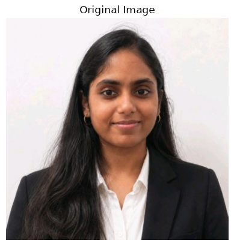


#2. Image with a line drawn from the top-left to the bottom-right.

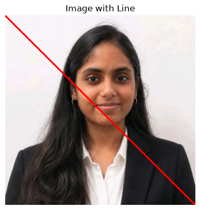


#3. Image with a circle at the center.

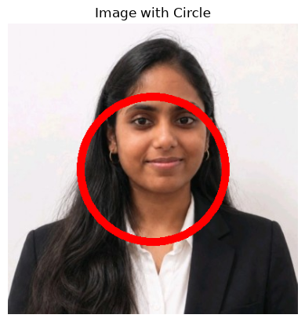


#4. Image with a rectangle around its boundary.

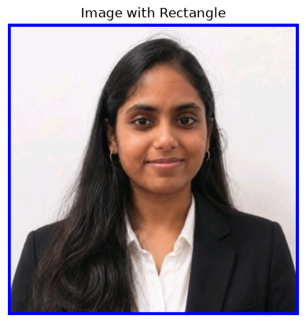


#5. Image with the text "OpenCV Drawing".

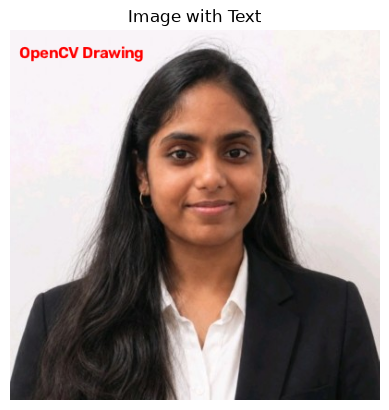


#6. Original RGB image.


#7. HSV color space conversion.

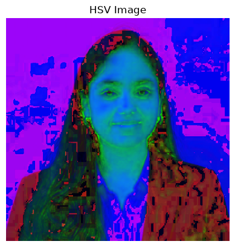


#8. Grayscale color space conversion.

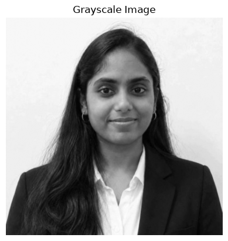


#9. YCrCb color space conversion.

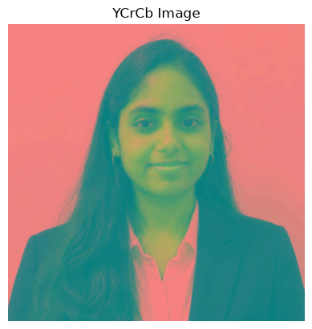


#10. Image converted from HSV back to RGB.

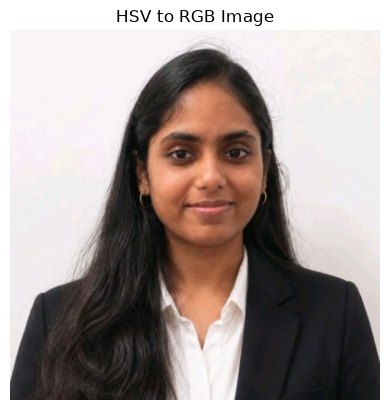


#11. Pixel region modified (white block).

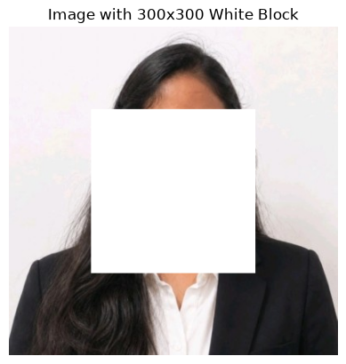


#12. Image resized to half its original dimensions.

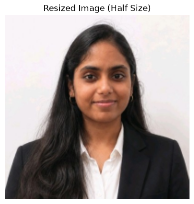


#13. Cropped region of interest displayed.

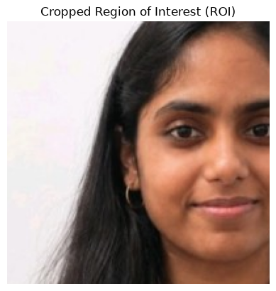


#14. Horizontally flipped image displayed.

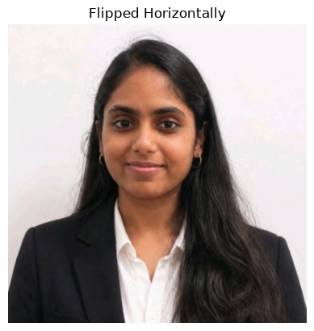


#15. Vertically flipped image displayed.

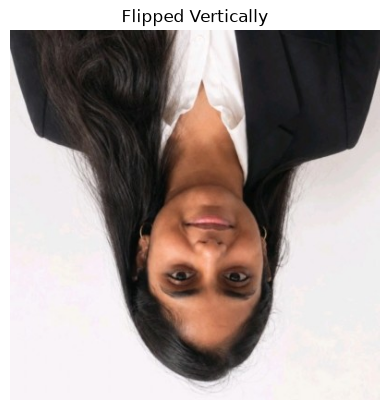


## RESULT

Thus, image handling and pixel transformations were performed using Python, OpenCV, and Matplotlib. The experiment demonstrated image reading, shape drawing, text insertion, color space conversion, pixel manipulation, image resizing, cropping, flipping, and saving.

---
