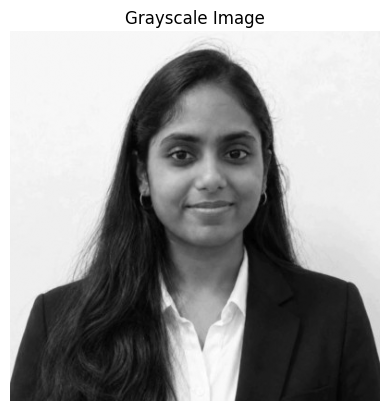
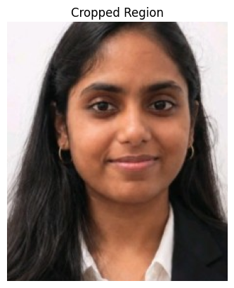
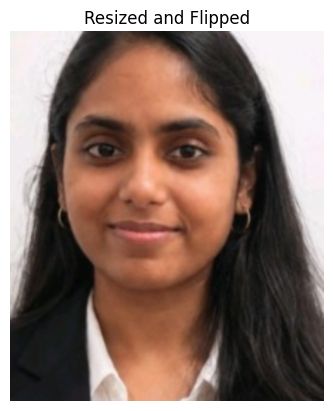
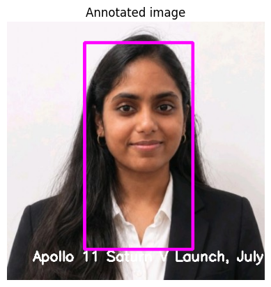
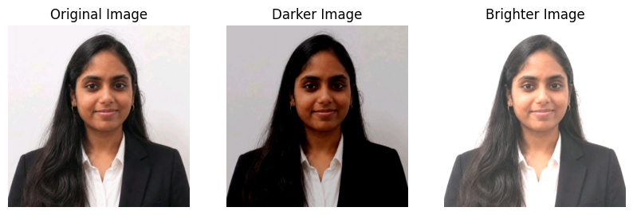
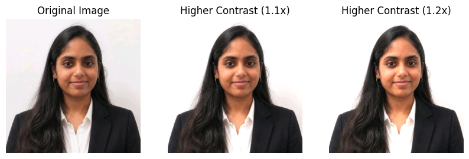
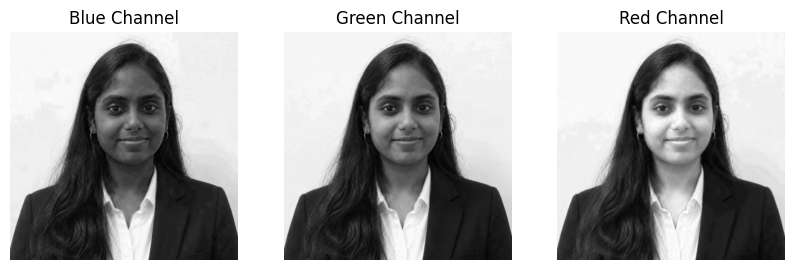
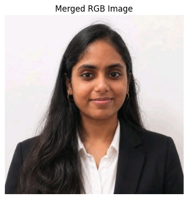
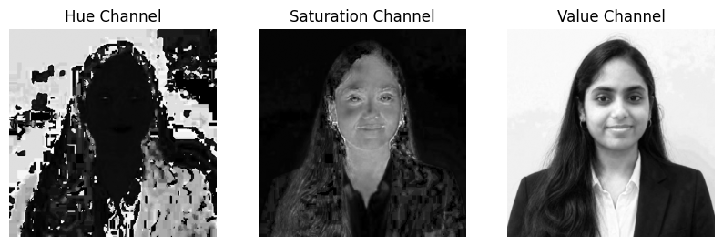
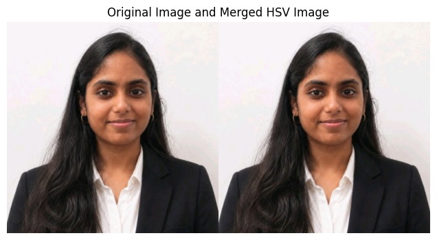

# EXP.NO-1: Image Handling and Pixel Transformations Using OpenCV

## Experiment Details

- **Name:** Ramitha Chowdary S
- **Register Number:** 212224240130

## Aim

Write a Python program using OpenCV that performs the following tasks:

1. Read and display an image.
2. Adjust the brightness of the image.
3. Modify the image contrast.
4. Split and merge colour channels.

## Software Required

- Anaconda, Python 3
- Jupyter Notebook
- OpenCV, NumPy, Matplotlib

## Algorithm

**Step 1:** Read ramitha.png, print the shape, and show the grayscale and colour versions.

**Step 2:** Save the photo as a PNG and read it back.

**Step 3:** Crop one region, resize that crop by 2x, and flip it horizontally.

**Step 4:** Write the given caption and draw a magenta rectangle on the photo.

**Step 5:** Add and subtract a constant matrix to make a brighter and a darker copy.

**Step 6:** Scale the pixels by 1.1 and 1.2 and clip the result to 0-255.

**Step 7:** Split B, G, R and H, S, V, then merge them again and display.

## Program

#### 1. Open the experiment folder

```python
import os
from google.colab import drive
drive.mount("/content/drive")
os.chdir("/content/drive/MyDrive/opencv-labs/01-Image-Handling-and-Pixel-Transformations-Using-OpenCV")
```

#### 2. Read the image and show grayscale

```python
import cv2
import numpy as np
import matplotlib.pyplot as plt

img = cv2.imread("ramitha.png")
img_rgb = cv2.cvtColor(img, cv2.COLOR_BGR2RGB)
gray = cv2.cvtColor(img, cv2.COLOR_BGR2GRAY)
print(gray.shape)
plt.imshow(gray, cmap="gray")
plt.title("Grayscale Image")
plt.axis("off")
plt.show()
```

#### 3. Save a PNG and show the colour image

```python
cv2.imwrite("ramitha_saved.png", img)
saved = cv2.imread("ramitha_saved.png")
saved_rgb = cv2.cvtColor(saved, cv2.COLOR_BGR2RGB)
print(saved_rgb.shape)
plt.imshow(saved_rgb)
plt.title("Colour Image")
plt.axis("off")
plt.show()
```

#### 4. Crop one region

```python
h, w = img_rgb.shape[:2]
crop = img_rgb[int(h * 0.12):int(h * 0.78), int(w * 0.22):int(w * 0.78)]
print(crop.shape)
plt.imshow(crop)
plt.title("Cropped Region")
plt.axis("off")
plt.show()
```

#### 5. Resize by 2x and flip horizontally

```python
bigger = cv2.resize(crop, None, fx=2, fy=2, interpolation=cv2.INTER_LINEAR)
flipped = cv2.flip(bigger, 1)
plt.imshow(flipped)
plt.title("Resized and Flipped")
plt.axis("off")
plt.show()
```

#### 6. Add the caption and a magenta rectangle

```python
photo = img_rgb.copy()
caption = "Apollo 11 Saturn V Launch, July 16, 1969"
cv2.putText(photo, caption, (40, photo.shape[0] - 30), cv2.FONT_HERSHEY_SIMPLEX, 0.7, (255, 255, 255), 2)
x1, y1 = int(w * 0.30), int(h * 0.08)
x2, y2 = int(w * 0.72), int(h * 0.88)
cv2.rectangle(photo, (x1, y1), (x2, y2), (255, 0, 255), 3)
plt.imshow(photo)
plt.title("Annotated image")
plt.axis("off")
plt.show()
```

#### 7. Brighter and darker

```python
matrix = np.ones(img_rgb.shape, dtype="uint8") * 50
brighter = cv2.add(img_rgb, matrix)
darker = cv2.subtract(img_rgb, matrix)
plt.figure(figsize=(10, 4))
plt.subplot(1, 3, 1)
plt.imshow(img_rgb)
plt.title("Original Image")
plt.axis("off")
plt.subplot(1, 3, 2)
plt.imshow(darker)
plt.title("Darker Image")
plt.axis("off")
plt.subplot(1, 3, 3)
plt.imshow(brighter)
plt.title("Brighter Image")
plt.axis("off")
plt.show()
```

#### 8. Contrast at 1.1 and 1.2

```python
scale_a = np.ones(img.shape, dtype="float32") * 1.1
scale_b = np.ones(img.shape, dtype="float32") * 1.2
high_a = np.clip(img.astype("float32") * scale_a, 0, 255).astype("uint8")
high_b = np.clip(img.astype("float32") * scale_b, 0, 255).astype("uint8")
plt.figure(figsize=(10, 4))
plt.subplot(1, 3, 1)
plt.imshow(img_rgb)
plt.title("Original Image")
plt.axis("off")
plt.subplot(1, 3, 2)
plt.imshow(cv2.cvtColor(high_a, cv2.COLOR_BGR2RGB))
plt.title("Higher Contrast (1.1x)")
plt.axis("off")
plt.subplot(1, 3, 3)
plt.imshow(cv2.cvtColor(high_b, cv2.COLOR_BGR2RGB))
plt.title("Higher Contrast (1.2x)")
plt.axis("off")
plt.show()
```

#### 9. Split B, G and R

```python
b, g, r = cv2.split(img)
plt.figure(figsize=(10, 4))
plt.subplot(1, 3, 1)
plt.imshow(b, cmap="gray")
plt.title("Blue Channel")
plt.axis("off")
plt.subplot(1, 3, 2)
plt.imshow(g, cmap="gray")
plt.title("Green Channel")
plt.axis("off")
plt.subplot(1, 3, 3)
plt.imshow(r, cmap="gray")
plt.title("Red Channel")
plt.axis("off")
plt.show()
```

#### 10. Merge RGB

```python
merged = cv2.merge([r, g, b])
plt.imshow(merged)
plt.title("Merged RGB Image")
plt.axis("off")
plt.show()
```

#### 11. Split H, S and V

```python
hsv = cv2.cvtColor(img, cv2.COLOR_BGR2HSV)
hh, ss, vv = cv2.split(hsv)
plt.figure(figsize=(10, 4))
plt.subplot(1, 3, 1)
plt.imshow(hh, cmap="gray")
plt.title("Hue Channel")
plt.axis("off")
plt.subplot(1, 3, 2)
plt.imshow(ss, cmap="gray")
plt.title("Saturation Channel")
plt.axis("off")
plt.subplot(1, 3, 3)
plt.imshow(vv, cmap="gray")
plt.title("Value Channel")
plt.axis("off")
plt.show()
```

#### 12. Merge HSV and place it beside the original

```python
merged_hsv = cv2.cvtColor(cv2.merge([hh, ss, vv]), cv2.COLOR_HSV2RGB)
side = np.concatenate((img_rgb, merged_hsv), axis=1)
plt.figure(figsize=(10, 4))
plt.imshow(side)
plt.title("Original Image and Merged HSV Image")
plt.axis("off")
plt.show()
```

## Output:
### **i)** Read and Display an Image.

1. Read ramitha.png as grayscale and display:



2. Save image as PNG and display:


3. Cropped image:



4. Resize and flip horizontally:



5. Display the final annotated image:



### **ii)** Adjust Image Brightness.

1. Create brighter and darker images and display:



### **iii)** Modify Image Contrast.

1. Modify contrast using scaling factors 1.1 and 1.2:



### **iv)** Split and Merge Colour Channels.

1. Split ramitha.png into B, G, R components and display:



2. Merge the R, G, B channels and display:



3. Split the image into H, S, V components and display:



4. Merge the H, S, V channels and display:



## Result

The photo was read and displayed, brightness and contrast were changed, and the colour channels were split and merged with OpenCV.
